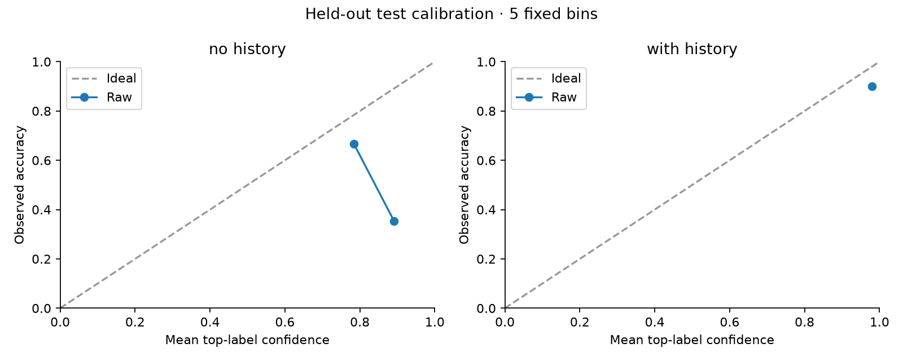
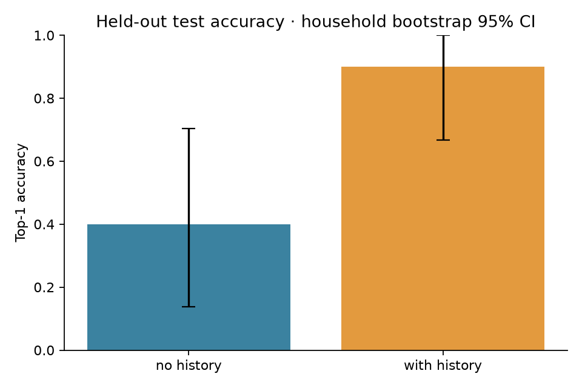
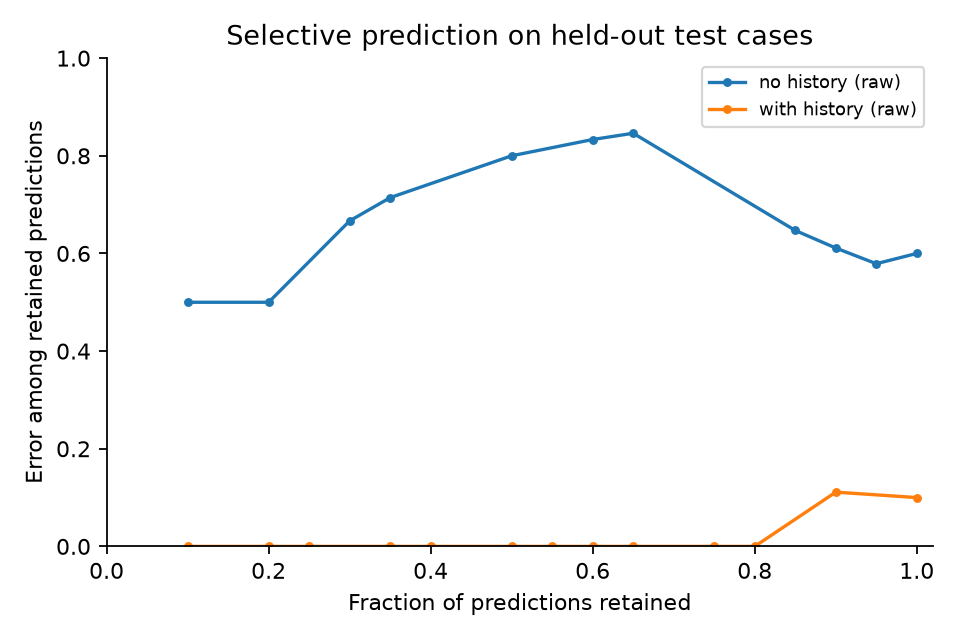

# Customer choice trust: experimental results

This report summarizes recorded model outputs. Scores describe held-out yogurt brand choices; they are not evidence about the customer's true psychological reasons.

## Prediction and confidence

| Condition | Confidence | Test cases | Accuracy | 95% CI | MRR | Log loss | Brier (sum) | ECE (5 bins) |
|---|---|---:|---:|---|---:|---:|---:|---:|
| no_history | Raw | 20 | 0.400 | [0.138, 0.703] | 0.679 | 2.113 | 1.009 | 0.475 |
| with_history | Raw | 20 | 0.900 | [0.667, 1.000] | 0.950 | 0.294 | 0.179 | 0.079 |

no_history: temperature = —; validation n = 0. No validation predictions; calibration skipped.

with_history: temperature = —; validation n = 0. No validation predictions; calibration skipped.

On 20 shared test cases, the paired accuracy difference (with history minus no history) is 0.500, household-bootstrap 95% CI [0.182, 0.755].

## Baselines

Baselines below use the same available test cases as each model condition. Support counts and population counts use +1 Laplace smoothing for probability metrics; the cheapest heuristic has only a hard-choice accuracy score.

| Condition | Baseline | Test cases | Accuracy | 95% CI | MRR | Log loss |
|---|---|---:|---:|---|---:|---:|
| no_history | Cheapest | 20 | 0.000 | [0.000, 0.000] | — | — |
| no_history | development_population | 20 | 0.050 | [0.000, 0.227] | 0.417 | 1.773 |
| no_history | Conditional multinomial logit | 20 | 0.300 | [0.037, 0.650] | 0.542 | 1.585 |
| with_history | Cheapest | 20 | 0.000 | [0.000, 0.000] | — | — |
| with_history | support_most_common | 20 | 1.000 | [1.000, 1.000] | 1.000 | 0.507 |
| with_history | development_population | 20 | 0.050 | [0.000, 0.227] | 0.417 | 1.773 |
| with_history | Conditional multinomial logit | 20 | 0.750 | [0.375, 1.000] | 0.875 | 0.667 |

Conditional logit is fitted only on development cases. Its features are development-standardized price, advertisement, brand constants, and (with-history condition only) the support brand frequency. L2 = 0.1 is fixed, without test tuning.

## Explanation faithfulness

Comprehensiveness and removal advantage are larger when removing cited evidence changes the original prediction more. Keep-only absolute change near zero means cited evidence preserves the original score; the signed sufficiency gap can also be negative, so a smaller signed value is not always better. Margin drop compares the original predicted brand against its fixed original runner-up. Margin advantage subtracts the matched-random margin drop. These are behavioral checks, not access to internal reasoning. Incorrect predictions remain evaluated against their original predicted label.

| Condition | Prediction group | Cases | Valid non-abstaining explanations | Parse success | Citation validity | Abstention |
|---|---|---:|---:|---:|---:|---:|
| no_history | all | 10 | 1 | 0.100 (n=10) | 0.100 (n=10) | 0.000 (n=10) |
| no_history | correct | 5 | 1 | 0.200 (n=5) | 0.200 (n=5) | 0.000 (n=5) |
| no_history | incorrect | 5 | 0 | 0.000 (n=5) | 0.000 (n=5) | 0.000 (n=5) |
| with_history | all | 10 | 10 | 1.000 (n=10) | 1.000 (n=10) | 0.000 (n=10) |
| with_history | correct | 10 | 10 | 1.000 (n=10) | 1.000 (n=10) | 0.000 (n=10) |
| with_history | incorrect | 0 | 0 | — (n=0) | — (n=0) | — (n=0) |

| Condition | Prediction group | Metric | Mean | 95% CI | Eligible cases | Households |
|---|---|---|---:|---|---:|---:|
| no_history | all | comprehensiveness | -0.007 | — | 1 | 1 |
| no_history | all | sufficiency_gap | -0.011 | — | 1 | 1 |
| no_history | all | keep_only_absolute_change | 0.011 | — | 1 | 1 |
| no_history | all | random_comprehensiveness_mean | 0.762 | — | 1 | 1 |
| no_history | all | random_sufficiency_gap_mean | 0.582 | — | 1 | 1 |
| no_history | all | removal_advantage | -0.769 | — | 1 | 1 |
| no_history | all | margin_drop | -1.087 | — | 1 | 1 |
| no_history | all | random_margin_drop_mean | 5.594 | — | 1 | 1 |
| no_history | all | margin_advantage | -6.681 | — | 1 | 1 |
| no_history | all | order_flip | 1.000 | — | 1 | 1 |
| no_history | correct | comprehensiveness | -0.007 | — | 1 | 1 |
| no_history | correct | sufficiency_gap | -0.011 | — | 1 | 1 |
| no_history | correct | keep_only_absolute_change | 0.011 | — | 1 | 1 |
| no_history | correct | random_comprehensiveness_mean | 0.762 | — | 1 | 1 |
| no_history | correct | random_sufficiency_gap_mean | 0.582 | — | 1 | 1 |
| no_history | correct | removal_advantage | -0.769 | — | 1 | 1 |
| no_history | correct | margin_drop | -1.087 | — | 1 | 1 |
| no_history | correct | random_margin_drop_mean | 5.594 | — | 1 | 1 |
| no_history | correct | margin_advantage | -6.681 | — | 1 | 1 |
| no_history | correct | order_flip | 1.000 | — | 1 | 1 |
| with_history | all | comprehensiveness | 0.135 | [-0.000, 0.406] | 10 | 5 |
| with_history | all | sufficiency_gap | -0.001 | [-0.047, 0.032] | 10 | 5 |
| with_history | all | keep_only_absolute_change | 0.032 | [0.005, 0.061] | 10 | 5 |
| with_history | all | random_comprehensiveness_mean | 0.020 | [0.000, 0.061] | 10 | 5 |
| with_history | all | random_sufficiency_gap_mean | 0.238 | [0.103, 0.423] | 10 | 5 |
| with_history | all | removal_advantage | 0.115 | [-0.001, 0.345] | 10 | 5 |
| with_history | all | margin_drop | -2.185 | [-4.729, 2.114] | 10 | 5 |
| with_history | all | random_margin_drop_mean | -1.767 | [-3.131, 0.812] | 10 | 5 |
| with_history | all | margin_advantage | -0.418 | [-2.978, 3.818] | 10 | 5 |
| with_history | all | counterfactual_agreement | 0.286 | [0.000, 0.500] | 7 | 3 |
| with_history | all | order_flip | 0.100 | [0.000, 0.300] | 10 | 5 |
| with_history | correct | comprehensiveness | 0.135 | [-0.000, 0.406] | 10 | 5 |
| with_history | correct | sufficiency_gap | -0.001 | [-0.047, 0.032] | 10 | 5 |
| with_history | correct | keep_only_absolute_change | 0.032 | [0.005, 0.061] | 10 | 5 |
| with_history | correct | random_comprehensiveness_mean | 0.020 | [0.000, 0.061] | 10 | 5 |
| with_history | correct | random_sufficiency_gap_mean | 0.238 | [0.103, 0.423] | 10 | 5 |
| with_history | correct | removal_advantage | 0.115 | [-0.001, 0.345] | 10 | 5 |
| with_history | correct | margin_drop | -2.185 | [-4.729, 2.114] | 10 | 5 |
| with_history | correct | random_margin_drop_mean | -1.767 | [-3.131, 0.812] | 10 | 5 |
| with_history | correct | margin_advantage | -0.418 | [-2.978, 3.818] | 10 | 5 |
| with_history | correct | counterfactual_agreement | 0.286 | [0.000, 0.500] | 7 | 3 |
| with_history | correct | order_flip | 0.100 | [0.000, 0.300] | 10 | 5 |

Invalid parses/citations and explicit abstentions are excluded from evidence-intervention means and retained in coverage denominators. Missing metrics are not treated as zero. Order-flip means include only cases where that test was actually run. Reported means apply to the sampled faithfulness cases; they do not automatically generalize to all test cases if selection was stratified or selective.

## Manually audited factual grounding

No eligible test explanations have completed claim-count reviews. Grounded and unsupported claim rates are unavailable; blank audit cells are not scored as zero.

## Verification and interpretation

- Confidence intervals use 500 household-cluster bootstrap draws with seed 42; an interval is omitted when fewer than two households are available.
- Calibration temperature is fitted separately by condition on validation predictions, then frozen before test scoring. Raw and calibrated test results are both retained.
- Raw probabilities are normalized model label scores conditional on the fixed four-brand prompt; calibration measures their agreement with observed choices.
- The multiclass Brier score sums squared errors across all four labels (range 0–2); log loss uses natural logarithms and probability floor 1e-12.
- Reliability uses five fixed bins; ECE can be unstable on small samples. Error-versus-coverage curves include all tied confidence scores at each cutoff.
- MRR uses the average rank for tied scores. Choice ties use alphabetical label order unless the recorded model prediction supplies another maximum-probability label.
- Support occasions are unordered. Whole-household splits prevent household overlap; these scores do not establish chronological forecasting performance.
- Altering prices, ads, or support facts tests model sensitivity. It does not reveal the real customer's counterfactual choice or supply a new observed label.

