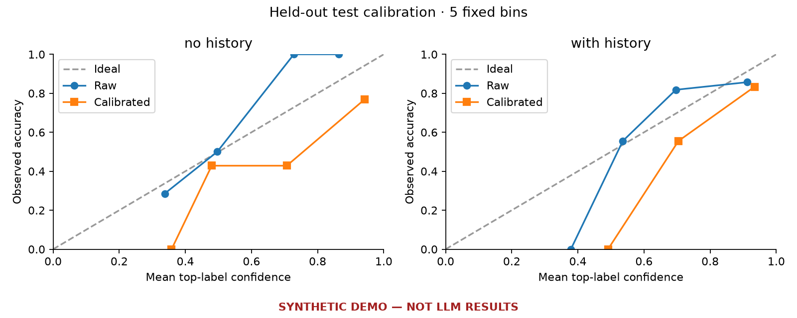
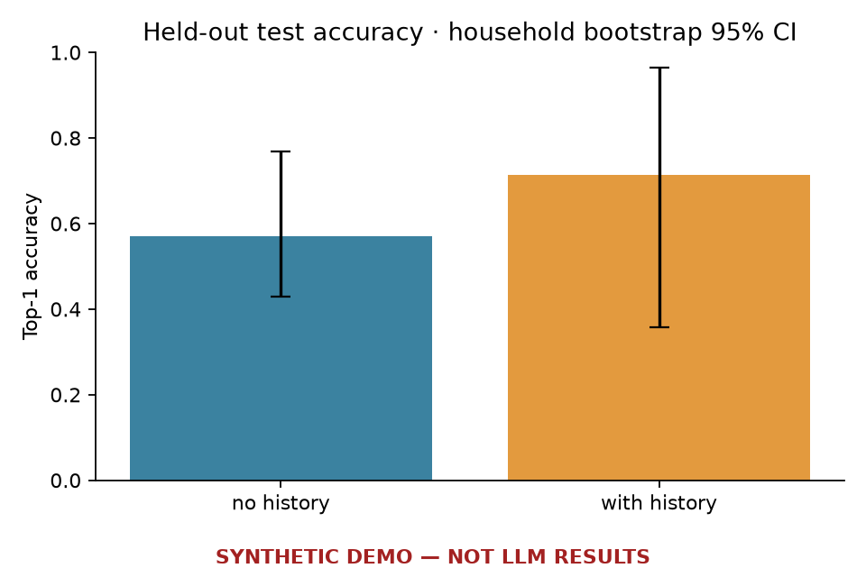
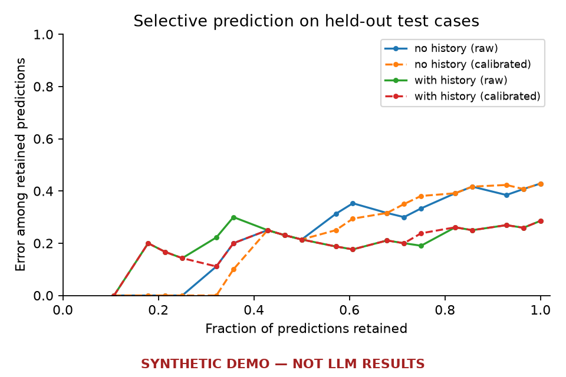

# SYNTHETIC DEMO — NOT LLM RESULTS

These are synthetic data and/or mock-backend scores used only to verify the workflow. They are not empirical LLM results and support no research conclusions.

## Prediction and confidence

| Condition | Confidence | Test cases | Accuracy | 95% CI | MRR | Log loss | Brier (sum) | ECE (5 bins) |
|---|---|---:|---:|---|---:|---:|---:|---:|
| no_history | Raw | 28 | 0.571 | [0.429, 0.769] | 0.744 | 0.993 | 0.540 | 0.078 |
| no_history | Calibrated | 28 | 0.571 | [0.429, 0.769] | 0.744 | 1.124 | 0.611 | 0.176 |
| with_history | Raw | 28 | 0.714 | [0.357, 0.964] | 0.833 | 0.777 | 0.425 | 0.081 |
| with_history | Calibrated | 28 | 0.714 | [0.357, 0.964] | 0.833 | 0.870 | 0.445 | 0.130 |

no_history: temperature = 0.372; validation n = 28. Fitted on validation only.

with_history: temperature = 0.547; validation n = 28. Fitted on validation only.

On 28 shared test cases, the paired accuracy difference (with history minus no history) is 0.143, household-bootstrap 95% CI [-0.143, 0.429].

## Baselines

Baselines below use the same available test cases as each model condition. Support counts and population counts use +1 Laplace smoothing for probability metrics; the cheapest heuristic has only a hard-choice accuracy score.

| Condition | Baseline | Test cases | Accuracy | 95% CI | MRR | Log loss |
|---|---|---:|---:|---|---:|---:|
| no_history | Cheapest | 28 | 0.500 | [0.321, 0.750] | — | — |
| no_history | development_population | 28 | 0.286 | [0.036, 0.679] | 0.580 | 1.366 |
| no_history | Conditional multinomial logit | 28 | 0.607 | [0.374, 0.857] | 0.756 | 0.991 |
| with_history | Cheapest | 28 | 0.500 | [0.321, 0.750] | — | — |
| with_history | support_most_common | 28 | 0.571 | [0.321, 0.786] | 0.729 | 1.142 |
| with_history | development_population | 28 | 0.286 | [0.036, 0.679] | 0.580 | 1.366 |
| with_history | Conditional multinomial logit | 28 | 0.643 | [0.357, 0.929] | 0.783 | 0.862 |

Conditional logit is fitted only on development cases. Its features are development-standardized price, advertisement, brand constants, and (with-history condition only) the support brand frequency. L2 = 0.1 is fixed, without test tuning.

## Explanation faithfulness

Comprehensiveness and removal advantage are larger when removing cited evidence changes the original prediction more. Keep-only absolute change near zero means cited evidence preserves the original score; the signed sufficiency gap can also be negative, so a smaller signed value is not always better. Margin drop compares the original predicted brand against its fixed original runner-up. Margin advantage subtracts the matched-random margin drop. These are behavioral checks, not access to internal reasoning. Incorrect predictions remain evaluated against their original predicted label.

| Condition | Prediction group | Cases | Valid non-abstaining explanations | Parse success | Citation validity | Abstention |
|---|---|---:|---:|---:|---:|---:|
| no_history | all | 20 | 20 | 1.000 (n=20) | 1.000 (n=20) | 0.000 (n=20) |
| no_history | correct | 12 | 12 | 1.000 (n=12) | 1.000 (n=12) | 0.000 (n=12) |
| no_history | incorrect | 8 | 8 | 1.000 (n=8) | 1.000 (n=8) | 0.000 (n=8) |
| with_history | all | 20 | 20 | 1.000 (n=20) | 1.000 (n=20) | 0.000 (n=20) |
| with_history | correct | 13 | 13 | 1.000 (n=13) | 1.000 (n=13) | 0.000 (n=13) |
| with_history | incorrect | 7 | 7 | 1.000 (n=7) | 1.000 (n=7) | 0.000 (n=7) |

| Condition | Prediction group | Metric | Mean | 95% CI | Eligible cases | Households |
|---|---|---|---:|---|---:|---:|
| no_history | all | comprehensiveness | -0.348 | [-0.388, -0.283] | 20 | 4 |
| no_history | all | sufficiency_gap | 0.467 | [0.405, 0.539] | 20 | 4 |
| no_history | all | keep_only_absolute_change | 0.467 | [0.405, 0.539] | 20 | 4 |
| no_history | all | random_comprehensiveness_mean | 0.221 | [0.159, 0.285] | 20 | 4 |
| no_history | all | random_sufficiency_gap_mean | 0.256 | [0.207, 0.350] | 20 | 4 |
| no_history | all | removal_advantage | -0.569 | [-0.656, -0.469] | 20 | 4 |
| no_history | all | margin_drop | -1.944 | [-2.273, -1.622] | 20 | 4 |
| no_history | all | random_margin_drop_mean | 0.280 | [-0.152, 0.697] | 20 | 4 |
| no_history | all | margin_advantage | -2.224 | [-2.841, -1.470] | 20 | 4 |
| no_history | all | counterfactual_agreement | 1.000 | [1.000, 1.000] | 20 | 4 |
| no_history | all | order_flip | 0.000 | [0.000, 0.000] | 20 | 4 |
| no_history | correct | comprehensiveness | -0.318 | [-0.359, -0.270] | 12 | 4 |
| no_history | correct | sufficiency_gap | 0.502 | [0.430, 0.554] | 12 | 4 |
| no_history | correct | keep_only_absolute_change | 0.502 | [0.430, 0.554] | 12 | 4 |
| no_history | correct | random_comprehensiveness_mean | 0.248 | [0.102, 0.320] | 12 | 4 |
| no_history | correct | random_sufficiency_gap_mean | 0.298 | [0.229, 0.374] | 12 | 4 |
| no_history | correct | removal_advantage | -0.566 | [-0.664, -0.428] | 12 | 4 |
| no_history | correct | margin_drop | -1.863 | [-2.065, -1.654] | 12 | 4 |
| no_history | correct | random_margin_drop_mean | 0.452 | [-0.273, 0.969] | 12 | 4 |
| no_history | correct | margin_advantage | -2.314 | [-2.981, -1.381] | 12 | 4 |
| no_history | correct | counterfactual_agreement | 1.000 | [1.000, 1.000] | 12 | 4 |
| no_history | correct | order_flip | 0.000 | [0.000, 0.000] | 12 | 4 |
| no_history | incorrect | comprehensiveness | -0.394 | [-0.449, -0.346] | 8 | 3 |
| no_history | incorrect | sufficiency_gap | 0.414 | [0.382, 0.456] | 8 | 3 |
| no_history | incorrect | keep_only_absolute_change | 0.414 | [0.382, 0.456] | 8 | 3 |
| no_history | incorrect | random_comprehensiveness_mean | 0.182 | [0.041, 0.237] | 8 | 3 |
| no_history | incorrect | random_sufficiency_gap_mean | 0.193 | [0.174, 0.257] | 8 | 3 |
| no_history | incorrect | removal_advantage | -0.575 | [-0.687, -0.458] | 8 | 3 |
| no_history | incorrect | margin_drop | -2.066 | [-2.702, -1.581] | 8 | 3 |
| no_history | incorrect | random_margin_drop_mean | 0.023 | [-0.180, 0.729] | 8 | 3 |
| no_history | incorrect | margin_advantage | -2.089 | [-2.822, -1.581] | 8 | 3 |
| no_history | incorrect | counterfactual_agreement | 1.000 | [1.000, 1.000] | 8 | 3 |
| no_history | incorrect | order_flip | 0.000 | [0.000, 0.000] | 8 | 3 |
| with_history | all | comprehensiveness | -0.216 | [-0.296, -0.139] | 20 | 4 |
| with_history | all | sufficiency_gap | 0.614 | [0.537, 0.719] | 20 | 4 |
| with_history | all | keep_only_absolute_change | 0.614 | [0.537, 0.719] | 20 | 4 |
| with_history | all | random_comprehensiveness_mean | 0.246 | [0.173, 0.311] | 20 | 4 |
| with_history | all | random_sufficiency_gap_mean | 0.390 | [0.310, 0.456] | 20 | 4 |
| with_history | all | removal_advantage | -0.462 | [-0.552, -0.375] | 20 | 4 |
| with_history | all | margin_drop | -1.614 | [-2.081, -1.289] | 20 | 4 |
| with_history | all | random_margin_drop_mean | 0.183 | [-0.108, 0.555] | 20 | 4 |
| with_history | all | margin_advantage | -1.798 | [-2.257, -1.323] | 20 | 4 |
| with_history | all | counterfactual_agreement | 1.000 | [1.000, 1.000] | 19 | 4 |
| with_history | all | order_flip | 0.000 | [0.000, 0.000] | 20 | 4 |
| with_history | correct | comprehensiveness | -0.181 | [-0.280, -0.035] | 13 | 3 |
| with_history | correct | sufficiency_gap | 0.648 | [0.527, 0.817] | 13 | 3 |
| with_history | correct | keep_only_absolute_change | 0.648 | [0.527, 0.817] | 13 | 3 |
| with_history | correct | random_comprehensiveness_mean | 0.283 | [0.266, 0.309] | 13 | 3 |
| with_history | correct | random_sufficiency_gap_mean | 0.431 | [0.327, 0.567] | 13 | 3 |
| with_history | correct | removal_advantage | -0.464 | [-0.546, -0.304] | 13 | 3 |
| with_history | correct | margin_drop | -1.496 | [-1.977, -0.917] | 13 | 3 |
| with_history | correct | random_margin_drop_mean | 0.234 | [-0.149, 0.580] | 13 | 3 |
| with_history | correct | margin_advantage | -1.730 | [-1.828, -1.497] | 13 | 3 |
| with_history | correct | counterfactual_agreement | 1.000 | [1.000, 1.000] | 13 | 3 |
| with_history | correct | order_flip | 0.000 | [0.000, 0.000] | 13 | 3 |
| with_history | incorrect | comprehensiveness | -0.282 | [-0.586, -0.202] | 7 | 3 |
| with_history | incorrect | sufficiency_gap | 0.551 | [0.371, 0.583] | 7 | 3 |
| with_history | incorrect | keep_only_absolute_change | 0.551 | [0.371, 0.583] | 7 | 3 |
| with_history | incorrect | random_comprehensiveness_mean | 0.176 | [0.127, 0.443] | 7 | 3 |
| with_history | incorrect | random_sufficiency_gap_mean | 0.315 | [0.028, 0.409] | 7 | 3 |
| with_history | incorrect | removal_advantage | -0.458 | [-0.818, -0.330] | 7 | 3 |
| with_history | incorrect | margin_drop | -1.833 | [-3.794, -1.216] | 7 | 3 |
| with_history | incorrect | random_margin_drop_mean | 0.089 | [-0.312, 1.289] | 7 | 3 |
| with_history | incorrect | margin_advantage | -1.923 | [-5.083, -0.904] | 7 | 3 |
| with_history | incorrect | counterfactual_agreement | 1.000 | [1.000, 1.000] | 6 | 2 |
| with_history | incorrect | order_flip | 0.000 | [0.000, 0.000] | 7 | 3 |

Invalid parses/citations and explicit abstentions are excluded from evidence-intervention means and retained in coverage denominators. Missing metrics are not treated as zero. Order-flip means include only cases where that test was actually run. Reported means apply to the sampled faithfulness cases; they do not automatically generalize to all test cases if selection was stratified or selective.

## Manually audited factual grounding

No eligible test explanations have completed claim-count reviews. Grounded and unsupported claim rates are unavailable; blank audit cells are not scored as zero.

## Verification and interpretation

- Confidence intervals use 500 household-cluster bootstrap draws with seed 42; an interval is omitted when fewer than two households are available.
- Calibration temperature is fitted separately by condition on validation predictions, then frozen before test scoring. Raw and calibrated test results are both retained.
- Raw probabilities are normalized model label scores conditional on the fixed four-brand prompt; calibration measures their agreement with observed choices.
- The multiclass Brier score sums squared errors across all four labels (range 0–2); log loss uses natural logarithms and probability floor 1e-12.
- Reliability uses five fixed bins; ECE can be unstable on small samples. Error-versus-coverage curves include all tied confidence scores at each cutoff.
- MRR uses the average rank for tied scores. Choice ties use alphabetical label order unless the recorded model prediction supplies another maximum-probability label.
- Support occasions are unordered. Whole-household splits prevent household overlap; these scores do not establish chronological forecasting performance.
- Altering prices, ads, or support facts tests model sensitivity. It does not reveal the real customer's counterfactual choice or supply a new observed label.

## Input notes

- SYNTHETIC DEMO — NOT LLM RESULTS: all reported scores are workflow checks, not empirical LLM findings.
